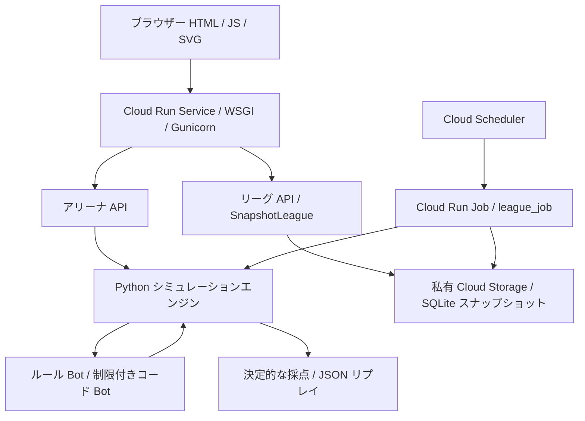

# システム構成

## 実行経路

Service は静的ファイルと API を同じオリジンで公開します。`server.py` と `league_api.py` をローカル HTTP と `wsgi.py` が共有します。ブラウザーは表示と入力を担当し、採点の決定権は持ちません。

## モジュールの責務

| モジュール | 責務 |
| --- | --- |
| `scenario.py` / `events.py` | seed による架空の道路・需要・イベント生成 |
| `engine.py` | 観測、行動検証、在庫・移動・配送、Dijkstra 型経路計算 |
| `bots.py` | 近距離・緊急度・最低充足率を使う決定的な方針 |
| `program_bot.py` | 制限付き AST 解釈。ネットワーク・ファイル・任意 Python 実行なし |
| `scoring.py` | C/T/F/E の採点、バージョン 0.1、重み 60/20/15/5 |
| `league.py` | 参加資格、結果保存、順位ポイント、同一時間帯の重複結算防止 |
| `league_store.py` | GCS generation 条件付きのスナップショット読書き、競合時の再計算 |
| `league_job.py` | 現在の UTC 時間帯を一度だけ結算 |
| `web/` | 三言語 UI、SVG 地図、比較・リプレイ表示 |

Bot の観測には発生済みイベントだけを含めます。完了後の試合記録には再現用情報が含まれます。地図の九つの視覚レイアウトは道路の表示位置を変えますが、輸送時間・規則・採点を変えません。

## 永続化と同時実行

ローカルは SQLite を直接使います。クラウドは私有 GCS オブジェクトが正本で、リクエストごとの一時 SQLite は作業コピーです。圧縮保存と最大 128 MiB の解凍上限を持ちます。generation が変われば最大 5 回まで再ロードして再計算し、成功した保存だけを成功と返します。ストレージ障害時は一時 DB に切り替えず 503 を返します。

完全なリプレイは最新ラウンドのみを保持し、古い結果・順位変動は保存します。1 回の API 呼出しでも複数のスナップショット読み込みが発生し得るため、大規模・高頻度アクセス向けではありません。

## Google Cloud の検証境界

Service の旧版は公開稼働しています。候補版は未デプロイです。GCS、Job、Scheduler、IAM の実装・設定スクリプトはありますが、実リソースの最終設定とログは次段階で確認します。Cloud Build / Artifact Registry の最終ビルド・digest も記録対象です。Gemini、Vertex AI、Google Maps、Firestore、Firebase は実行経路に含みません。

[デプロイ](16-deployment.md) / [リーグ構築](25-league-deployment.md) / [受入記録](18-mvp-acceptance.md)
